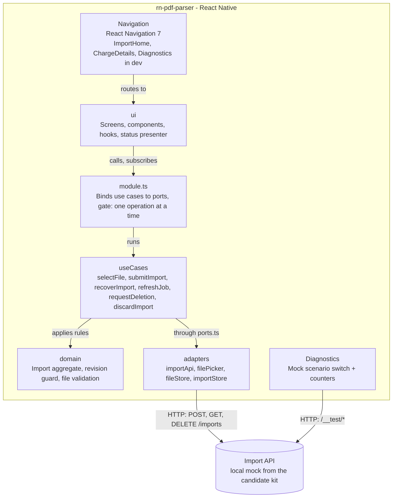
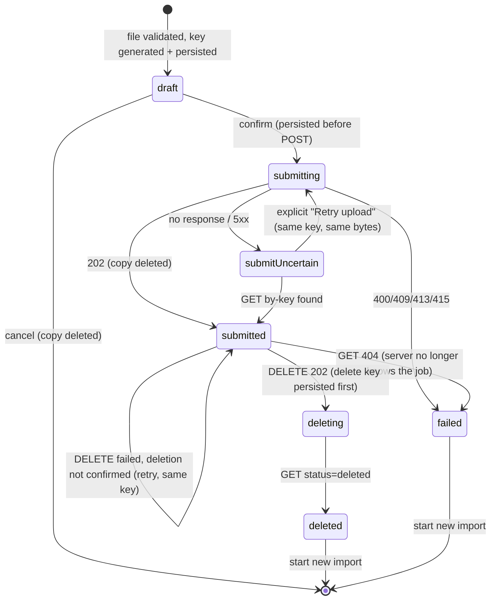
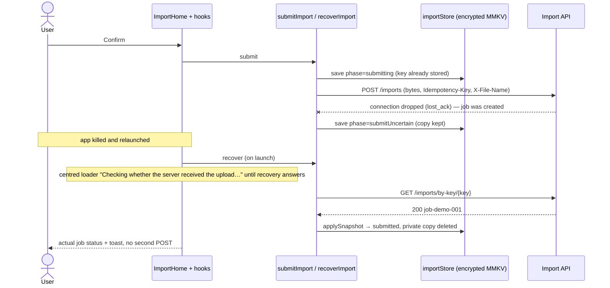
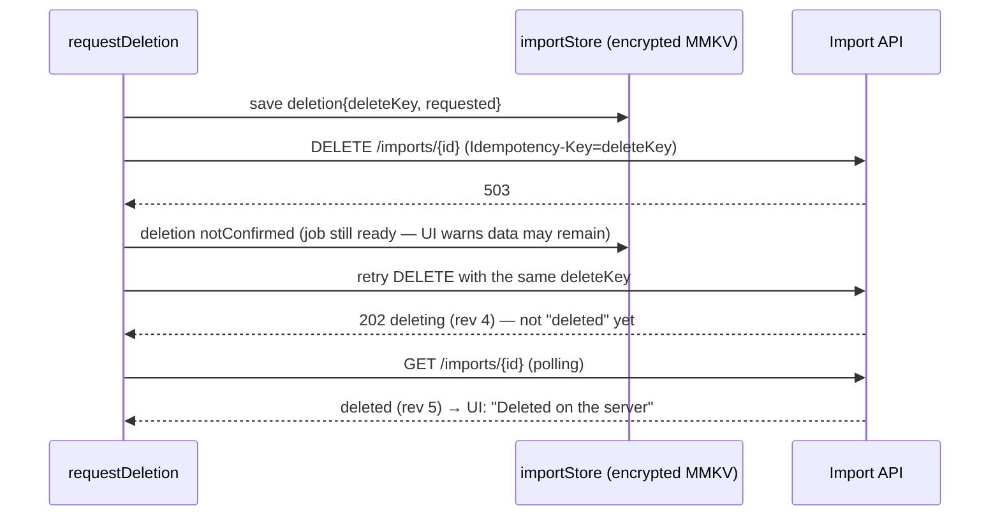

# Statement Import Mobile Architecture

- **Status:** Review · **Owner:** Gleb · **Updated:** 2026-10-15
- **System:** standalone test assignment (no system architecture document; the only backend is the local candidate-kit mock)
- **Bounded context:** Statement import
- **Framework:** React Native 0.87 (New Architecture, Hermes), bare workflow

The mobile container lets a user pick a synthetic bank statement (PDF/CSV), validates it **on the device**, uploads its raw bytes to the import API with a persisted idempotency key, follows the asynchronous job until a report is ready, and deletes the import through a separate asynchronous operation. Behaviour under failure (lost acknowledgement, app relaunch, stale responses, failed deletion) is the primary concern; the number of screens is deliberately small.

Design session answers:

- **Context:** mobile only
- **Personal data:** a bank statement is a person's private financial data — no file bytes, file names or transaction descriptions in logs; local copies are short-lived and state is encrypted (task privacy rules; the kit's data is synthetic)
- **Quality attributes:** correctness under failure over latency
- **Multi-tenancy:** no
- **Offline:** no offline mode, but every operation survives a relaunch
- **Greenfield:** yes

## Component Diagram



| Component   | Description                                                                                                                                                                                                                |
| ----------- | -------------------------------------------------------------------------------------------------------------------------------------------------------------------------------------------------------------------------- |
| domain      | Pure TypeScript. Import aggregate (phases, job snapshot, deletion), `applySnapshot` revision guard, file validation (size + magic bytes, mirrors the server byte-for-byte), monthly total.                                 |
| ports.ts    | The only contract between use cases and the outside world: `IImportApi`, `IFilePicker`, `IFileStore`, `IImportStore` + `now()` / `generateKey()`.                                                                          |
| useCases    | One function per scenario `(deps) => Promise<Result>`: select, submit, recover (incl. orphan-copy sweep), refresh, request deletion, discard.                                                                              |
| module.ts   | Composition root of the feature: binds use cases to their ports and serialises them with a gate, so concurrent taps/polls can't produce a second request.                                                                  |
| adapters    | Driven side: `importApi` (fetch + Zod anti-corruption parsing), `filePicker`, `fileStore`, `importStore` (AES-256 MMKV, key from Keychain/Keystore).                                                                       |
| ui          | Driving side: screens, components, hooks (`useImportSession` = recovery + polling) and a pure presenter (`toImportStatusView`, `toStatusToast`) that decides which status, actions and notifications are truthful to show. |
| Diagnostics | Developer/reviewer tool: switch mock scenarios, read `/__test/state` counters, show the mock address in use (configured via `.env`). Registered only in dev builds.                                                        |

## Layout

```
src/
  app/            App, bootstrap (composition root + device adapters), navigation, i18n, theme init, @types
  shared/         Result, logger (allow-listed fields), config (.env address), ids, net, encoding, format, i18n,
                  navigation (routes), theme, components (Button, Banner, Card, …)
  features/
    statementImport/
      domain/           statementImport.ts (aggregate + rules), validateFile.ts
      ports.ts          interfaces for everything outside the app
      useCases/         one function per scenario
      module.ts         composition + gate
      adapters/         importApi, filePicker, fileStore, importStore
      ui/               screens/, components/, hooks/, statusPresenter.ts, Context
      i18n/ constants/
    diagnostics/        ports.ts, adapters/, ui/ (simple tier: hook → port)
jest/             test support: real-mock harness (integration), UI render harness
mock-server/      unchanged candidate kit
.maestro/         E2E flows + fixture provisioning
```

Dependencies point inward (`ui → module → useCases → domain`; `adapters` implement `ports.ts`; device adapters are wired in `app/bootstrap`); `shared` imports nothing from features; nothing imports `app`.

## Statement Import

### Use Cases

| Actor    | UC ID | Use Case                                                                            | Priority |
| -------- | ----- | ----------------------------------------------------------------------------------- | -------- |
| User     | UC-01 | Pick a PDF/CSV, see name/size/format, reject spoofed or >10 MiB files before upload | Must     |
| User     | UC-02 | Upload real bytes with a persisted idempotency key; see queued/processing/ready     | Must     |
| User     | UC-03 | Recover an unknown upload outcome (lost ack / kill) by key without re-sending       | Must     |
| User     | UC-04 | See two recurring charges and the monthly total; open a read-only detail card       | Must     |
| User     | UC-05 | Delete the import; deletion is claimed only after the server reports `deleted`      | Must     |
| User     | UC-06 | Clear all local data (copies + state)                                               | Should   |
| Reviewer | UC-07 | Switch mock scenarios and read counters on the device                               | Should   |

### Screens & Navigation

| Screen                  | Route                      | Data Loading                                                                        | UC Ref   |
| ----------------------- | -------------------------- | ----------------------------------------------------------------------------------- | -------- |
| ImportHomeScreen        | `ImportHome`               | Persisted import via `useSyncExternalStore`; renders empty / confirm / status panel | UC-01…06 |
| ChargeDetailsScreen     | `ChargeDetails {chargeId}` | Persisted report                                                                    | UC-04    |
| DiagnosticsScreen (dev) | `Diagnostics`              | `/__test/state` on focus                                                            | UC-07    |

A single home screen renders the step that matches the persisted state, so a relaunch always lands on the right step without replaying navigation.

### Import lifecycle



### Flows

#### UC-02/03: Upload, lost acknowledgement, relaunch



#### UC-05: Deletion with a failure



### Components

| Component              | Purpose                                         | Props                                   |
| ---------------------- | ----------------------------------------------- | --------------------------------------- |
| ImportEmptyState       | Picker entry (a rejection is shown as a toast)  | picking, onPickFile                     |
| ConfirmFilePanel       | Name, size, detected format; confirm / cancel   | statementImport                         |
| ImportStatusPanel      | Status banner, deletion notice, report, actions | statementImport                         |
| ReportCard / ChargeRow | Two charges, monthly total, "Details"           | report, monthlyTotalLabel, onOpenCharge |
| ClearLocalDataSection  | Local wipe (not a server deletion)              | clearing, onClear                       |

## UI Feedback and Adaptive Layout

- **Events vs states.** The result of an action is a toast (top of the screen, one at a time, auto-hides, never takes touches, announced to screen readers): file rejected, request failed, upload accepted, report ready, upload result unknown, deletion confirmed / not confirmed, local data cleared. Status-change toasts come from `toStatusToast(previous, next)` comparing two persisted imports, so polling, recovery and taps all notify the same way and a relaunch never replays old events. The import status and "deletion not confirmed" stay as on-screen banners. Diagnostics shows no toasts.
- **Loading.** An action shows a spinner in its own button (all actions disabled while one runs). A whole-screen wait — app start (Keychain + store), first Diagnostics load, and a relaunch with an unconfirmed upload until the by-key lookup answers — shows `ScreenLoader` (spinner + text) in the middle of the screen.
- **Small screens.** Unistyles breakpoints by width (`compact` < 390 pt/dp ≤ `regular`); theme font sizes and spacing use `compactOr(compact, regular)`, so components adapt without per-screen code. Touch targets stay ≥ 48 dp. Every screen is a `ScrollView` (`ScreenContainer`); the report has two items, so no virtualised list.
- **Large fonts.** Text follows the system font scale up to 2× (`MAX_FONT_SCALE`; the header button 1.5×), so iOS accessibility sizes don't break words. Native header title: 16 pt, centred on both platforms.
- **Verified:** Maestro 5/5 on iPhone 17 Pro and iPhone SE (iOS 26.5), Pixel 3a and a 360×640 dp Android (Android 14), and at 2× font on Android; the largest iOS accessibility size checked screen by screen.

## Platform-Specific Modules

No custom native code. Community native modules only:

| Module                         | Platform      | Native API                                                                                                            | Purpose                                   |
| ------------------------------ | ------------- | --------------------------------------------------------------------------------------------------------------------- | ----------------------------------------- |
| @react-native-documents/picker | iOS / Android | UIDocumentPicker (import mode: OS temp copy, original untouched) / Storage Access Framework (`content://`, open mode) | Pick and copy the statement               |
| react-native-file-access       | both          | FileManager / java.io                                                                                                 | stat, head-bytes read, read, move, unlink |
| react-native-mmkv (Nitro)      | both          | MMKV, AES-256                                                                                                         | Persisted import state                    |
| react-native-keychain          | both          | Keychain (`WhenUnlockedThisDeviceOnly`) / Keystore                                                                    | MMKV encryption key                       |

## Offline Capability

| Feature | Offline Support              | Sync Strategy                                                             | Conflict Resolution                                                        |
| ------- | ---------------------------- | ------------------------------------------------------------------------- | -------------------------------------------------------------------------- |
| Import  | None (requests fail visibly) | State persisted before every write request; recovery on launch/foreground | Server is authoritative; monotonic revisions; deleting/deleted is terminal |

## State Management

- Server state: persisted aggregate (encrypted MMKV) is the single source of truth, read via `useSyncExternalStore`; recovery + polling live in `ui/hooks/useImportSession.ts` (`setInterval` 1 s while pending, stopped while the app is in background).
- Global state: React Context only for the composition roots (feature modules).
- Form state: none (no forms; the mock address comes from `.env`).

## Performance Targets

| Metric        | Target                                                                | Ref     |
| ------------- | --------------------------------------------------------------------- | ------- |
| Upload memory | ≤ 3 × file size transiently (file ≤ 10 MiB, validated before reading) | TDR-005 |
| Polling       | 1 request/s per pending job, paused in background                     | TDR-006 |

## Shared Components

| Component                   | Purpose                                               | Used By                           |
| --------------------------- | ----------------------------------------------------- | --------------------------------- |
| Button                      | ≥48dp touch target, loading/disabled, a11y role/state | statementImport, diagnostics      |
| Banner                      | Persistent state message, live region                 | statementImport, diagnostics, app |
| Toast (provider + hook)     | Event notifications: success / warning / error        | statementImport                   |
| ScreenLoader                | Whole-screen loading state (spinner + text)           | app, statementImport, diagnostics |
| Card, KeyValueRow, HintText | Wrapping layout for large fonts (text capped at 2×)   | statementImport, diagnostics      |
| ScreenContainer             | Scrollable safe-area screen                           | all screens                       |

## Third-Party SDKs

| SDK | Purpose                                      | Data Transmitted                                      |
| --- | -------------------------------------------- | ----------------------------------------------------- |
| —   | No analytics, crash reporting or remote SDKs | Nothing leaves the device except the import API calls |

## PII Handling

- Logging exclusion: `ILogger` accepts only allow-listed fields (`jobId`, `status`, `revision`, `phase`, `code`); bytes, file names, URIs and merchant descriptions cannot be logged by type. Dev builds only.
- Crash reporting: none.
- UI: toasts and banners show translated messages by error code only — never a file name, URI or server error text.
- Transport: plain HTTP to the local mock; Android allows cleartext in debug builds only, iOS `NSAllowsLocalNetworking` (local addresses only) is in all builds — see TDR-003.
- Data at rest: AES-256 MMKV; private copy under a neutral name (`<uuid>.bin`) removed as soon as the server holds the job, on cancel/rejection/failure, and by the orphan sweep at the start of every recovery (launch / foreground).
- Backups: `allowBackup="false"` + data-extraction rules exclude everything from cloud backup and device transfer.
- Task switcher: not blurred (synthetic data) — see TDR-003.

## ADRs

- [ADR-001 Simplified hexagonal feature layout with TDD](adrs/rn-pdf-parser-ADR-001-hexagonal-feature-layout.md)
- [ADR-002 Idempotent upload, recovery by key, revision guard](adrs/rn-pdf-parser-ADR-002-idempotent-upload-and-recovery.md)
- [ADR-003 Encrypted local state with a Keychain/Keystore key](adrs/rn-pdf-parser-ADR-003-encrypted-local-state.md)

## TDRs

- [TDR-001 npm instead of pnpm + mise](tdrs/rn-pdf-parser-TDR-001-npm-instead-of-pnpm.md)
- [TDR-002 No OpenTelemetry / crash reporting](tdrs/rn-pdf-parser-TDR-002-no-observability.md)
- [TDR-003 No certificate pinning, cleartext to the local mock, no task-switcher blur](tdrs/rn-pdf-parser-TDR-003-transport-and-screen-privacy.md)
- [TDR-004 Single active import](tdrs/rn-pdf-parser-TDR-004-single-active-import.md)
- [TDR-005 Upload reads the file into JS memory](tdrs/rn-pdf-parser-TDR-005-in-memory-upload.md)
- [TDR-006 Fixed polling interval](tdrs/rn-pdf-parser-TDR-006-fixed-polling.md)
